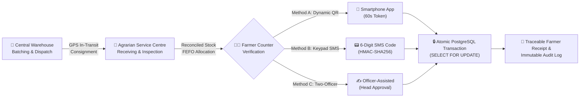
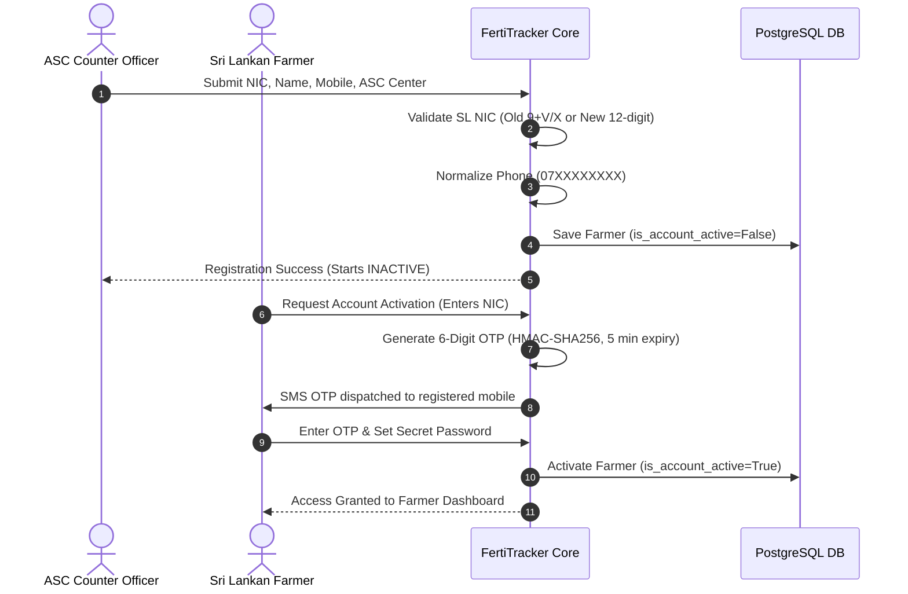
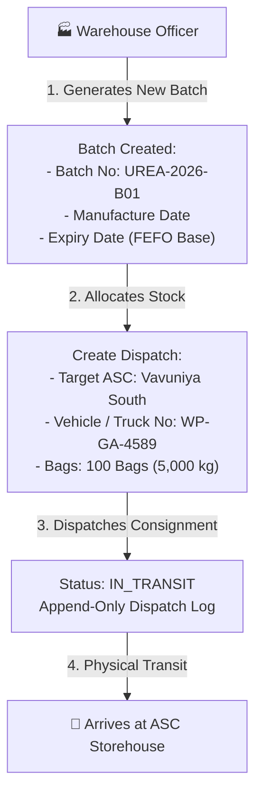
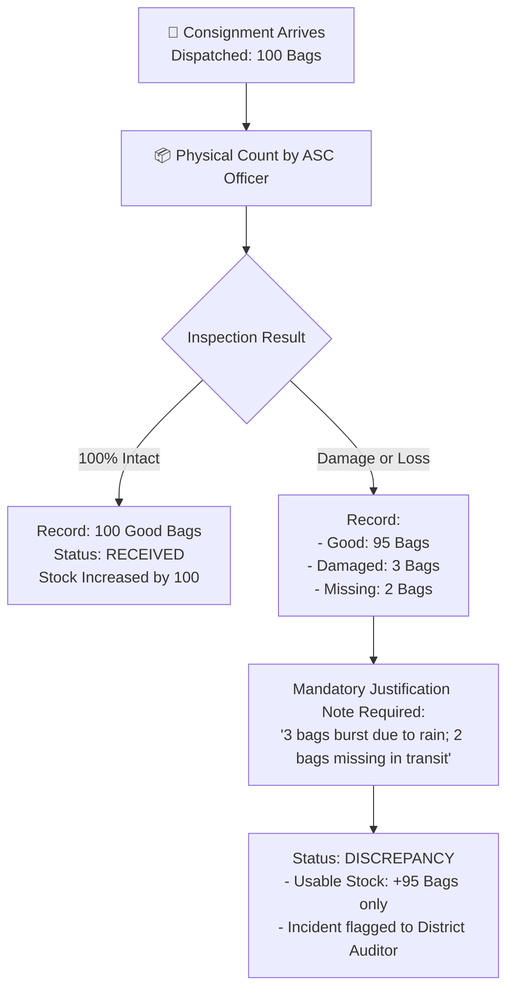
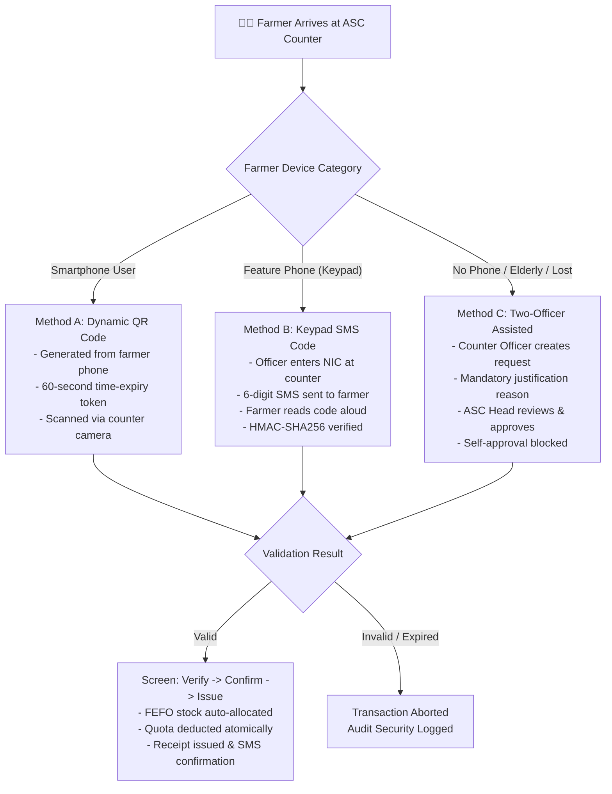
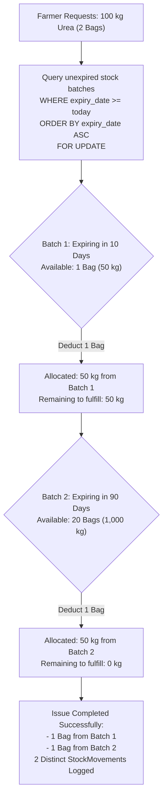
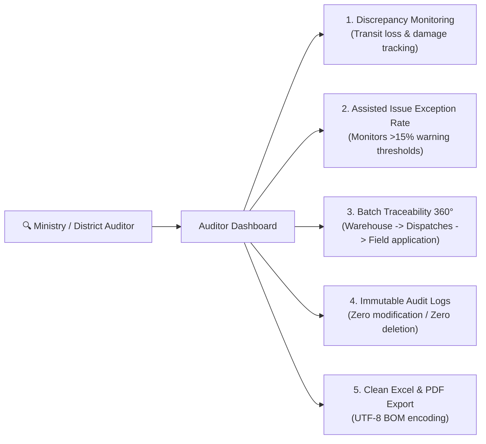

# 🌾 REPUBLIC OF SRI LANKA
## MINISTRY OF AGRICULTURE & PLANTATION INDUSTRIES
### DEPARTMENT OF AGRARIAN DEVELOPMENT

---

# FertiTracker™ — National Fertilizer Stock & Farmer Distribution Traceability System
## Comprehensive System Operational Manual & Official Technical Report
**Document Reference**: `AGR/FT/DOC/2026/V1.0`  
**Classification**: Official / Operational Standard Operating Procedure (SOP)  
**Target Audience**: Department Officials, ASC Agrarian Officers, Warehouse Officers, District Auditors, Policy Makers  
**Effective Season**: Maha 2026/2027 & Subsequent Cultivation Cycles  

---

## 📑 TABLE OF CONTENTS
1. [Executive Summary & Policy Context](#1-executive-summary--policy-context)
2. [Institutional Hierarchy & Role-Based Access Control (RBAC)](#2-institutional-hierarchy--role-based-access-control-rbac)
3. [End-to-End System Architecture](#3-end-to-end-system-architecture)
4. [Master Data & Cultivation Season Management (Admin SOP)](#4-master-data--cultivation-season-management-admin-sop)
5. [Farmer Registration & Entitlement Quota Management (ASC SOP)](#5-farmer-registration--entitlement-quota-management-asc-sop)
6. [Central Warehouse Dispatch & Batch Traceability (Warehouse SOP)](#6-central-warehouse-dispatch--batch-traceability-warehouse-sop)
7. [ASC Receiving, Physical Verification & Discrepancy Reconciliation](#7-asc-receiving-physical-verification--discrepancy-reconciliation)
8. [Farmer Distribution & Verification Workflows (Counter SOP)](#8-farmer-distribution--verification-workflows-counter-sop)
   - 8.1 Method A: Dynamic QR Code Verification (Smartphone Farmers)
   - 8.2 Method B: Keypad SMS Verification (Feature Phone Farmers)
   - 8.3 Method C: Officer-Assisted Issue & Two-Officer Rule (Excluded Farmers)
9. [First-Expired-First-Out (FEFO) Engine & Expired Stock Disposal](#9-first-expired-first-out-fefo-engine--expired-stock-disposal)
10. [Audit Oversight, Forensic Reporting & Data Export (Auditor SOP)](#10-audit-oversight-forensic-reporting--data-export-auditor-sop)
11. [Data Security, Cryptographic Protection & Append-Only Guarantees](#11-data-security-cryptographic-protection--append-only-guarantees)
12. [Hardware Requirements & Ground Deployment Guide](#12-hardware-requirements--ground-deployment-guide)
13. [Appendix: Operational Checklist Quick-Reference](#13-appendix-operational-checklist-quick-reference)

---

## 1. EXECUTIVE SUMMARY & POLICY CONTEXT

### 1.1 Background & The Paper-Register Deficit
For decades, Agrarian Service Centres (ASCs) throughout Sri Lanka's 25 administrative districts have maintained agricultural fertilizer subsidy distributions using handwritten paper ledgers. This legacy method suffers from four critical vulnerabilities:
1. **Supply Chain Disconnection**: Fertilizer manufacturers and central storage warehouses (e.g., Lak Pohora, Colombo Commercial Fertilizers) dispatch stock without real-time synchronization with physical ASC storehouse inventory.
2. **Quota Leakage & Double-Dipping**: Paper coupons, chits, and rubber stamps can be replicated, presented multiple times at different counters, or utilized by unauthorized third parties without physical identity verification.
3. **Loss in Transit & Concealed Discrepancies**: Transport losses (damaged bags, physical spillage, or missing bags) remain unrecorded or unresolved due to the absence of mandatory digital reconciliation ledgers.
4. **Fertilizer Quality Degradation (Lack of FEFO)**: In typical storehouses, newly delivered bags are stacked in front of older bags. ASC officers issue newly received stock while older fertilizer cakes, absorbs humidity, and expires, harming soil health and agricultural productivity.

### 1.2 The FertiTracker Solution
**FertiTracker** is a secure, cloud-ready, tri-lingual (Sinhala, Tamil, English) traceability platform developed specifically for Sri Lanka's agrarian ecosystem. It unifies every link of the fertilizer supply chain—from regional warehouse dispatch to individual farmer field application—into an immutable, cryptographically verifiable digital ledger.



---

## 2. INSTITUTIONAL HIERARCHY & ROLE-BASED ACCESS CONTROL (RBAC)

The system enforces strict principle-of-least-privilege Role-Based Access Control (RBAC). User accounts are compartmentalized into distinct institutional tiers:

| Institutional Role | Target Officials | Primary Operational Scope | Security Permissions |
|---|---|---|---|
| **System Administrator** | Ministry IT Directorate, Colombo HQ | Master data, cultivation season activation, user provisioning, global system parameters. | Full administrative read/write; User creation/deactivation; Master catalog editing. |
| **Warehouse Officer** | Regional Warehouse Managers (e.g., Northern Hub) | Fertilizer batch creation, production expiry date assignment, dispatch creation to ASCs. | Batch creation; Dispatch initiation; Transit monitoring. Cannot issue to farmers. |
| **ASC Counter Officer** | Agrarian Development Officers (ADOs), Counter Clerks | Dispatch receiving & physical bag verification; Farmer registration; Scanning QR / SMS verification; Counter fertilizer issuance. | Receiving dispatches; Registering farmers; Issuing fertilizer. Cannot approve self-assisted requests. |
| **ASC Head Officer** | Divisional Officer (DO), Senior Agrarian Research Assistant | Administrative head of the ASC; Oversees operations; Authorizes officer-assisted issues (Two-Officer Rule); Authorizes expired stock write-offs. | All Counter Officer actions + Assisted Issue Approvals + Stock Write-Off authorization. |
| **Auditor** | Internal Ministry Auditors, Auditor General's Dept | Forensic oversight; Transit loss and discrepancy monitoring; Exception rate tracking; Audit log interrogation. | Read-only across all dispatches, distributions, receipts, and system audit logs. Strictly blocked from POST/modifying operations. |
| **Registered Farmer** | Land-owning & Tenant Cultivators (Beneficiaries) | Personal quota monitoring; Viewing remaining balances; Generating single-use dynamic QR codes. | Read-only access to personal entitlements and receipts; QR token generation. |

---

## 3. END-TO-END SYSTEM ARCHITECTURE

FertiTracker is designed for high reliability, zero data corruption, and robust operation in low-bandwidth rural environments:

- **Core Web Framework**: Python 3.12 / Django 6.1 leveraging standard Django Internationalization (`gettext`, `.po` and `.mo` catalogs).
- **Relational Storage & ACID Integrity**: PostgreSQL 16 utilizing row-level database locking (`SELECT ... FOR UPDATE`) to prevent race conditions during concurrent counter issuances.
- **Client-Side Scanner**: In-browser JavaScript HTML5 QR Code engine (`html5-qrcode`) utilizing the native `MediaDevices.getUserMedia()` API, eliminating the need for farmers or officers to install proprietary mobile app packages.
- **SMS Gateway Subsystem**: Pluggable architecture operating via `SimulatedSMSBackend` for local evaluation, seamlessly switchable to government telco gateways (Mobitel m-Space, Dialog IdeaMart).
- **Reporting & Printing Engine**: Browser-native `@media print` CSS rendering paired with Microsoft Excel-compliant CSV exports pre-pended with the UTF-8 Byte Order Mark (`\ufeff`) to render Sinhala and Tamil characters without font corruption.

---

## 4. MASTER DATA & CULTIVATION SEASON MANAGEMENT (ADMIN SOP)

### 4.1 Cultivation Season Lifecycle & Single-Open Invariant
In Sri Lanka, agricultural activities are strictly governed by the **Maha** (major wet season) and **Yala** (minor dry season) cultivation cycles. 

> [!IMPORTANT]
> **Single Active Season Invariant**:
> The system enforces a strict mathematical invariant: **at any given moment, exactly one cultivation season may hold `ACTIVE` status nationwide**. Activating a new season automatically transitions all previously open seasons to `CLOSED`.

#### Operational Steps to Manage Seasons:
1. Log in as **System Administrator** (`admin`).
2. Navigate to **Administration Dashboard** $\rightarrow$ **Cultivation Seasons**.
3. To open a new season (e.g., *Maha 2026/2027*):
   - Click **"Activate Season"**.
   - The system executes an atomic transaction that sets the target season to `ACTIVE` and all other records to `CLOSED`.
4. When a season is `CLOSED`:
   - All fertilizer issuances for that season are immediately blocked at database level.
   - All historical distribution records, receipts, and reports remain permanently accessible in read-only mode.

### 4.2 Provisioning Institutional Officer Accounts
To prevent credential misuse and ghost accounts, individual officers cannot self-register:
1. Navigate to **User Management** $\rightarrow$ **Officer Accounts** (`/accounts/officers/`).
2. Complete the officer profile: Username, Full Name, Email, Government Role (`wh_officer`, `asc_officer`, `asc_head`, `auditor`), and Assigned ASC Centre.
3. Click **"Create Officer Account"**.
4. The system automatically creates the account with a cryptographically secure 12-character random temporary password (`secrets.token_urlsafe(9)`), displayed **once** in a highlighted notice.
5. The account is flagged with `must_change_password=True`.
6. Upon the officer's first login, the portal automatically intercepts the session and forces the officer to establish a private, strong password adhering to national security standards (minimum 8 characters, non-numeric, not common).
7. If an officer is transferred or suspended, the Administrator clicks **"Deactivate Account"**. The account is locked from logging in, but historical audit signatures associated with that user are preserved.

---

## 5. FARMER REGISTRATION & ENTITLEMENT QUOTA MANAGEMENT (ASC SOP)



### 5.1 In-Person Farmer Registration
Every beneficiary farmer must be registered by an authorized ASC Officer upon verifying original physical documentation:
1. Navigate to **Farmer Directory** $\rightarrow$ **Register New Farmer** (`/distributions/farmers/`).
2. Enter the farmer's **National Identity Card (NIC)** number:
   - *Legacy Format*: 9 numeric digits followed by `V` or `X` (e.g., `197512345V`).
   - *Modern Format*: Exactly 12 numeric digits (e.g., `198512345678`).
3. Enter the mobile phone number (normalized to Sri Lankan mobile format: `07XXXXXXXX`).
4. Select the farmer's registered Agrarian Service Centre (e.g., *Vavuniya South ASC*).
5. Click **"Register Farmer"**. The profile is created in an **`INACTIVE`** state (`is_account_active=False`). The farmer cannot log in until two-factor SMS activation is fulfilled.

### 5.2 Two-Factor SMS Account Activation & Password Reset
1. The farmer visits the FertiTracker portal and clicks **"Activate Account / Forgot Password"** (`/accounts/activate/`).
2. The farmer inputs their registered NIC.
3. **Anti-Enumeration Security**: The system returns a generic confirmation message regardless of whether the NIC exists, preventing malicious probing.
4. If valid, an HMAC-SHA256 hashed 6-digit OTP is generated (valid for 5 minutes).
5. The farmer inputs the OTP and selects a personal password.
6. The system verifies the token using timing-safe comparison (`hmac.compare_digest`). Upon verification, the farmer account is marked `ACTIVE`.

### 5.3 High-Security Phone Number Update Workflow
If a farmer changes their SIM card or mobile number:
1. The farmer must appear in person before the ASC Counter Officer.
2. The officer enters the new phone number and must check the mandatory statutory declaration:  
   ☑ *"I hereby confirm that I have verified the farmer's physical NIC in person."*
3. The system saves the number and records an immutable log entry in `AuditLog` containing masked representations of both the previous and new numbers (e.g., `077****233` $\rightarrow$ `071****677`).

### 5.4 Bulk Entitlement Quota Import (Two-Phase Verification)
Agrarian quota allocations based on cultivated land acreage (e.g., Urea, MOP, TSP kg per hectare) are provided by the Ministry in CSV format.

> [!TIP]
> **Two-Phase Import Workflow**:
> To prevent partial or corrupt data imports, FertiTracker requires an explicit **Upload $\rightarrow$ Preview & Validation $\rightarrow$ Atomic Commit** sequence.

1. Navigate to **Manage Farmers & Entitlements** $\rightarrow$ **Bulk Import Quotas**.
2. Click **"Download Sample CSV"** (`/distributions/entitlements/csv-sample/`). The template provides clean headers with an embedded UTF-8 BOM (`\ufeff`) preventing character corruption in Microsoft Excel:
   ```csv
   nic,product,quantity_kg
   197512345V,UREA,150.00
   198512345678,MOP,50.00
   ```
3. Upload the populated CSV file.
4. **Phase 1: Validation Preview**:
   - The system displays an interactive table highlighting every row.
   - Any unknown NICs, invalid product codes, or negative values are flagged with **Red Warning Badges**.
   - If any errors exist, the **"Confirm & Commit Import"** button is disabled.
5. **Phase 2: All-or-Nothing Commit**:
   - Once all rows are verified, clicking **"Confirm & Commit Import"** executes the updates inside an atomic database transaction (`@transaction.atomic`). If any database error occurs, the entire batch rolls back.
   - Every individual entitlement adjustment automatically records previous and new values in the audit trail.

---

## 6. CENTRAL WAREHOUSE DISPATCH & BATCH TRACEABILITY (WAREHOUSE SOP)

Central fertilizer warehouses receive bulk chemical imports and prepare consignments for distribution to district ASCs.



### 6.1 Creating a Fertilizer Batch
1. Log in as **Warehouse Officer** (`wh_officer`).
2. Navigate to **Warehouse Inventory** $\rightarrow$ **New Fertilizer Batch**.
3. Record the batch details:
   - **Product**: Urea (Granular), Muriate of Potash (MOP), or Triple Super Phosphate (TSP).
   - **Batch Number**: Unique identifier (e.g., `UREA-2026-B01`).
   - **Manufacture Date**: Calendar date of bagging.
   - **Expiry Date**: Expiration date (crucial for FEFO ordering).
   - **Total Quantity Bags**: Bag weight standardized at 50 kg per bag.
4. Click **"Save Batch"**.

### 6.2 Initiating Consignment Dispatch
1. Navigate to **Dispatches** $\rightarrow$ **Create Dispatch**.
2. Select the target **Agrarian Service Centre** (e.g., *Vavuniya South ASC*).
3. Select the originating **Fertilizer Batch**.
4. Specify the **Number of Bags Dispatched**.
5. Input the transport details: **Driver Name** and **Vehicle Registration Number** (e.g., `WP-GA-4589`).
6. Click **"Dispatch Consignment"**.
7. The dispatch is created in **`IN_TRANSIT`** status. A tracking barcode/consignment note is generated for the transport driver.

---

## 7. ASC RECEIVING, PHYSICAL VERIFICATION & DISCREPANCY RECONCILIATION

When a fertilizer consignment arrives at an ASC, physical goods must be reconciled against the warehouse dispatch note before stock is made available for distribution.



### 7.1 Receiving Inspection SOP
1. Log in as **ASC Counter Officer** (`asc_officer`) or **ASC Head** (`asc_head`).
2. On the dashboard, review the **"Incoming Dispatches"** notification badge.
3. Click **"Receive Dispatch"** on the matching consignment note.
4. Conduct physical verification at the storehouse door and enter:
   - **Received Good Bags**: Undamaged, sealed bags ready for distribution.
   - **Damaged Bags**: Bags torn, water-damaged, or caked during transit.
   - **Missing Bags**: Discrepancy between the dispatch manifest and the physical count.
5. **Validation Rule**: `Dispatched Bags == Received Good + Damaged + Missing`. The system rejects any submission where the sum does not equal the manifest total.

### 7.2 Handling Damaged and Missing Stock
- If `Damaged Bags > 0` or `Missing Bags > 0`, the dispatch status automatically transitions to **`DISCREPANCY`**.
- The officer **must provide a detailed explanation** in the justification note field (e.g., *"3 bags punctured due to rough road transit; driver noted 2 bags missing from trailer"*). Submissions without an explanatory note are blocked.
- **Stock Math**: **Only Good Bags** are credited to the active storehouse inventory (`ASCStock`). Damaged and missing bags are isolated in the permanent discrepancy register for administrative investigation.
- An alert is automatically broadcast to the **Auditor Dashboard**.

---

## 8. FARMER DISTRIBUTION & VERIFICATION WORKFLOWS (COUNTER SOP)

To serve all citizens equitably, FertiTracker provides **three inclusive verification pathways**:



---

### 8.1 Method A: Dynamic QR Code Verification (Smartphone Beneficiaries)

For farmers possessing smartphones with web browser access:
1. **Farmer Step**:
   - The farmer visits the mobile portal (`/accounts/farmer-dashboard/`).
   - Clicks **"Generate Distribution QR"**.
   - An encrypted, opaque token is generated and rendered as a high-contrast QR code on the farmer's display.
   - **Security Guarantee**: The token is single-use and automatically expires in **60 seconds**.
2. **Counter Officer Step (Scan $\rightarrow$ Verify $\rightarrow$ Confirm $\rightarrow$ Issue)**:
   - The officer clicks the large **"Scan QR Code"** button on the counter dashboard.
   - The browser activates the USB webcam or terminal camera via `getUserMedia`.
   - The officer scans the farmer's QR code.
   - **Verify Phase**: The system displays the farmer's masked identity, photo reference, registered acreage, and available fertilizer quotas. Stock is not yet deducted.
   - **Confirm & Issue Phase**: The officer selects the quantity to issue (e.g., 2 bags of Urea = 100 kg) and clicks **"Confirm Fertilizer Issue"**.
   - The atomic transaction executes row-level locking, deducts stock, invalidates the token, and renders the printable receipt.

---

### 8.2 Method B: Keypad SMS Verification (Feature Phone Beneficiaries)

For rural farmers possessing basic 2G/3G keypad feature phones (Nokia, etc.) without cameras or internet access:
1. The farmer presents their physical NIC at the ASC counter.
2. The officer navigates to **"SMS Backup Code Issue"** (`/distributions/sms-issue/`) and inputs the farmer's NIC.
3. The system generates an ephemeral 6-digit numeric code:
   - Stored in the database as a keyed **HMAC-SHA256** hash (cannot be decrypted or reversed).
   - Valid for **5 minutes** only.
   - Strictly bound to the issuing ASC (cannot be redeemed at another centre).
4. The farmer's feature phone receives an automated SMS:  
   `"FertiTracker: Your verification code for Vavuniya South ASC is 482915. Valid for 5 minutes. Do not share."`
5. The farmer reads the 6 digits aloud to the counter officer.
6. The officer types the code into the verification portal.
7. **Brute-Force Safeguard**: If an incorrect code is entered 5 consecutive times, manual entry is temporarily locked for 10 minutes, the token is permanently invalidated, and a security alert is recorded in the audit log.
8. Upon successful entry, the transaction proceeds to the standard confirmation screen.

---

### 8.3 Method C: Officer-Assisted Issue & Two-Officer Rule (Excluded Beneficiaries)

To ensure that elderly, disabled, or illiterate farmers who have lost their phones or lack cellular connectivity are never denied their lawful fertilizer entitlements, the system provides a controlled **Officer-Assisted Issue Workflow**:

> [!CAUTION]
> **Statutory Two-Officer Separation of Duty**:
> To prevent counter fraud, **an officer can never approve their own assisted issue request**. Approval strictly requires a second, higher-ranking officer (ASC Head).

1. **Step 1: Request Creation (Counter Officer)**:
   - Navigate to **"Officer-Assisted Issue"** (`/distributions/assisted-issue/create/`).
   - Search for the farmer by NIC.
   - Select the mandatory statutory justification:
     - `NO_PHONE` — Farmer does not own a mobile phone.
     - `PHONE_DEAD_OR_NO_SIGNAL` — Battery depleted or cellular network unavailable.
     - `SMS_GATEWAY_FAILURE` — Network gateway failure.
     - `ELDERLY_OR_DISABLED` — Citizen unable to operate digital device.
     - `OTHER` — Exceptional administrative circumstance.
   - If `OTHER` is selected, an explanatory note is strictly mandatory.
   - Click **"Submit for ASC Head Approval"**. The request status is set to `PENDING_APPROVAL`.
2. **Step 2: Independent Review & Approval (ASC Head Officer)**:
   - The ASC Head logs in and inspects the **"Pending Assisted Approvals"** queue.
   - The ASC Head personally inspects the farmer's physical documentation and clicks **"Approve Assisted Request"**.
   - If the counter officer who created the request attempts to click Approve, the database engine aborts the request with `ValidationError("You cannot approve your own assisted issue request")`.
3. **Step 3: Counter Fulfillment**:
   - The approved request appears on the counter terminal with an active **30-minute validity countdown**.
   - The counter officer completes physical delivery of the fertilizer bags and clicks **"Issue Stock"**.
   - The system flags the issue method as `ASSISTED` in the audit logs.

---

## 9. FIRST-EXPIRED-FIRST-OUT (FEFO) ENGINE & EXPIRED STOCK DISPOSAL

### 9.1 Mathematical FEFO Stock Allocation
Fertilizer chemical compounds (specifically Urea) cake and lose nitrogen efficacy if stored under humid conditions. FertiTracker incorporates an automated **First-Expired-First-Out (FEFO)** algorithm inside the central distribution engine:



#### FEFO Rules Enforced by System Logic:
1. **Earliest-Expiry Priority**: The system queries active storehouse stock ordered ascending by `batch__expiry_date`.
2. **Multi-Batch Splitting**: If the earliest-expiring batch contains insufficient bags to satisfy the farmer's quota, the engine deducts all available bags from that batch and seamlessly draws the balance from the next earliest-expiring batch.
3. **Distinct Stock Movements**: Every batch tapped during an issue generates an individual outbound `StockMovement` row, guaranteeing 100% forensic traceability of which batch was given to which farmer.
4. **Strict Expired Batch Exclusion**: Batches with `expiry_date < today` are classified as **`EXPIRED`**. The allocation algorithm strictly filters them out; expired stock cannot be issued under any circumstances.

### 9.2 Expired Stock Write-Off Protocol
If a fertilizer consignment expires in storehouse custody due to unforeseen circumstances:
1. Physical bags are marked as condemned and isolated in the storehouse.
2. The **ASC Head** accesses **Stock Management** $\rightarrow$ **Expired Stock Write-Off** (`/inventory/write-off/`).
3. The ASC Head selects the expired batch, inputs the number of condemned bags, and enters a mandatory official disposal justification.
4. **Append-Only Accounting**: The system **does not delete database records**. It records an outbound `StockMovement(movement_type='WRITE_OFF')` and appends an entry to `AuditLog`. The on-hand balance is reduced to zero, preserving an unbroken historical paper trail for government auditors.

---

## 10. AUDIT OVERSIGHT, FORENSIC REPORTING & DATA EXPORT (AUDITOR SOP)

Ministry auditors possess comprehensive real-time visibility across the island:



### 10.1 Key Audit Metrics on the Auditor Dashboard
- **Total Discrepancies**: Aggregate count of damaged and missing fertilizer bags recorded during ASC receiving.
- **Assisted Issue Ratio**: Percentage of issues executed via the Two-Officer assisted workflow. If an ASC exhibits an assisted rate exceeding **15%**, the dashboard highlights the centre with an **Exception Alert Badge**, triggering an administrative inquiry into potential counter manipulation.
- **Condemned / Expired Stock**: Total tonnage written off across regional centres.

### 10.2 360° Batch Traceability Lifecycle Explorer
Auditors can input any batch code (e.g., `UREA-2026-B01`) at `/distributions/reports/batch-trace/` to inspect its entire supply chain chronology:
1. **Creation Stage**: Manufacturing facility, bagging date, and expiry date.
2. **Transit Stage**: Dispatches to ASCs, vehicle registration numbers, and transit durations.
3. **Receiving Stage**: Good bags accepted vs. damaged/missing bags quarantined.
4. **Custody Stage**: Current on-hand stock distributed across ASC storehouses.
5. **Beneficiary Stage**: Comprehensive list of farmers who received fertilizer from that batch, including timestamps, issuing officers, and masked NICs.
6. **Reconciliation Formula**:  
   $$\text{Dispatched Bags} = \text{Good Bags Received} + \text{Damaged Bags} + \text{Missing Bags} + \text{In-Transit Bags}$$

### 10.3 Forensic CSV & PDF Export Standards
- **UTF-8 Byte Order Mark (`\ufeff`) Compliance**: All CSV reports are generated with a UTF-8 BOM. When district officers open reports in Microsoft Excel on Windows, Sinhala and Tamil characters render flawlessly without mojibake (`à¶à·...`).
- **Browser-Native PDF Printing**: Rather than relying on Python libraries that break complex Sinhala and Tamil Unicode ligatures, reports utilize `@media print` stylesheets. Clicking **"Print / Save PDF"** invokes the browser's native text engine to produce crisp, legally compliant PDF documents.

---

## 11. DATA SECURITY, CRYPTOGRAPHIC PROTECTION & APPEND-ONLY GUARANTEES

FertiTracker incorporates bank-grade defense-in-depth principles:

### 11.1 Concurrency & ACID Row-Level Locking
To prevent race conditions where two counter officers simultaneously issue the same fertilizer stock or redeem the same farmer entitlement:
- All critical database updates are wrapped in `@transaction.atomic`.
- Candidate stock records are retrieved using `select_for_update()`.
- On PostgreSQL, this acquires an exclusive row-level lock (`SELECT ... FOR UPDATE`). Concurrent requests block until the active transaction commits, guaranteeing that stock and farmer quotas can never be overdrawn below zero.

### 11.2 Cryptographic Hash Security
- **Dynamic QR Tokens**: 256-bit cryptographically secure pseudo-random hex strings with a strict 60-second TTL.
- **SMS Backup Codes & Activation OTPs**: Stored in the database using a **keyed HMAC-SHA256 hash** salted with a secret server key. Plaintext codes are never stored in the database. Comparisons use constant-time `hmac.compare_digest()` to eliminate timing-attack vulnerabilities.

### 11.3 Append-Only AuditLog Immutability
To ensure forensic evidence is admissible in court, the `AuditLog` table enforces programmatic immutability at three distinct application layers:
1. **Model Level**: The `.save()` method raises `ValidationError` if an existing primary key is detected. The `.delete()` method raises `ValidationError` unconditionally.
2. **QuerySet Level**: A custom `AuditLogQuerySet` overrides `.update()` and `.delete()`, preventing bulk modifications (e.g., `AuditLog.objects.filter(...).delete()`).
3. **Admin Console Level**: The Django Admin registration explicitly disables `has_add_permission`, `has_change_permission`, and `has_delete_permission`.

### 11.4 Privacy by Design & Data Minimization
In compliance with the Sri Lanka Personal Data Protection Act (PDPA No. 9 of 2022):
- Citizen National Identity Card numbers are masked in all public-facing screens, receipt printouts, and audit views (e.g., `1975****1111` or `1985****5678`).
- Farmer telephone numbers are masked in audit records and counter interfaces (e.g., `077****501`).
- All active user sessions are subject to a **30-minute idle session timeout** (`SESSION_COOKIE_AGE = 1800`).

---

## 12. HARDWARE REQUIREMENTS & GROUND DEPLOYMENT GUIDE

### 12.1 Recommended Hardware at ASC Centres
- **Workstation**: Standard desktop PC or laptop running Windows 10/11 or Ubuntu Linux (Intel Core i3, 4GB RAM minimum).
- **Display**: Minimum $1280 \times 720$ resolution for counter dashboards.
- **Barcode / QR Scanner**: Any plug-and-play USB 2D barcode scanner OR a standard USB webcam (720p or higher).
- **Receipt Printer**: Standard 80mm thermal receipt printer OR standard A4 laser printer.
- **Network**: 3G/4G cellular dongle or fixed broadband (bandwidth requirement is extremely low, $<50$ KB per transaction).

### 12.2 Deployment & Cloudflare Tunnel Setup (Expo & Live Counter)
Because modern mobile web browsers require an **HTTPS** context to grant camera access for HTML5 QR scanning, field testing and exhibition setups should utilize a secure Cloudflare Tunnel:

```powershell
# 1. Start the Django application server
.venv\Scripts\python manage.py runserver 127.0.0.1:8000

# 2. Expose the server over a secure HTTPS Cloudflare Tunnel
cloudflared tunnel --url http://127.0.0.1:8000
```
- The tunnel outputs an ephemeral public HTTPS URL (e.g., `https://xxxx.trycloudflare.com`).
- Counter officers and farmers can open this URL directly on smartphones and tablets with full camera functionality.

---

## 13. APPENDIX: OPERATIONAL CHECKLIST QUICK-REFERENCE

### Daily Morning Checklist for ASC Counter Officers
- [ ] Log in at `/accounts/login/` using assigned government credentials.
- [ ] Verify that the current Cultivation Season displayed on the top bar is **ACTIVE**.
- [ ] Inspect the **Incoming Dispatches** card. If physical trucks have arrived, complete the Receiving Inspection before opening the issue counter.
- [ ] Review storehouse **Stock Health Badges** (`HEALTHY`, `LOW STOCK`, `NEAR EXPIRY`).
- [ ] Verify USB camera or barcode scanner connectivity by testing one sample scan.

### Daily Closing Checklist for ASC Head Officers
- [ ] Review the **Pending Assisted Issues** queue; ensure no pending approvals are left unfulfilled.
- [ ] Check the **Today's Distribution Summary** (Total kg issued and farmer count).
- [ ] If any expired bags have reached condemnation date, execute the **Expired Stock Write-Off** protocol with a clear justification note.
- [ ] Export the daily distribution ledger to CSV for backup archiving.
- [ ] Ensure all counter workstations are logged out.

---

**Approved for Official Agricultural Distribution by**:  
*Department of Agrarian Development, Sri Lanka*  
*TICT3153 — Software Engineering Project | ICT Expo 5.0, University of Vavuniya*
