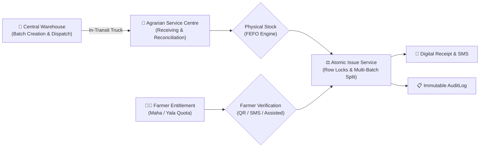
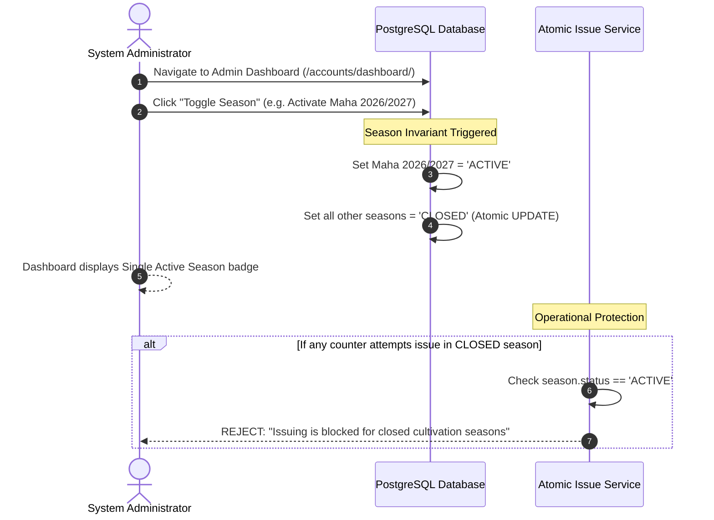
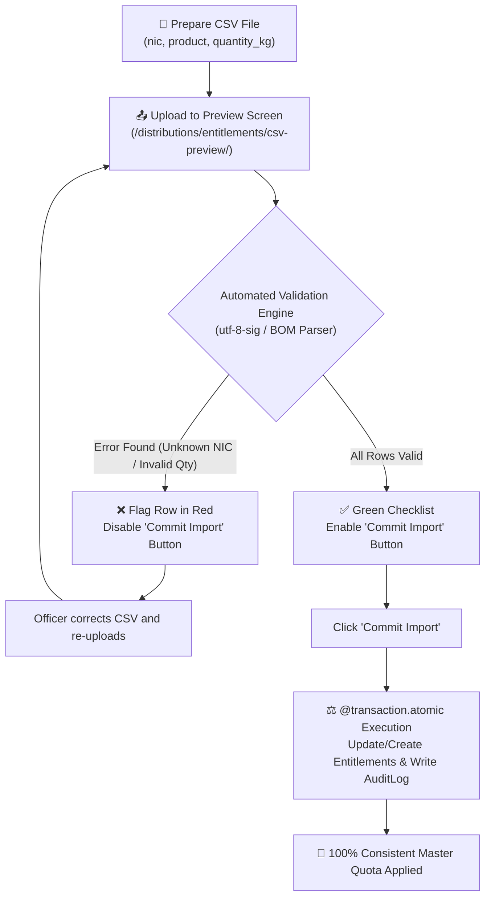
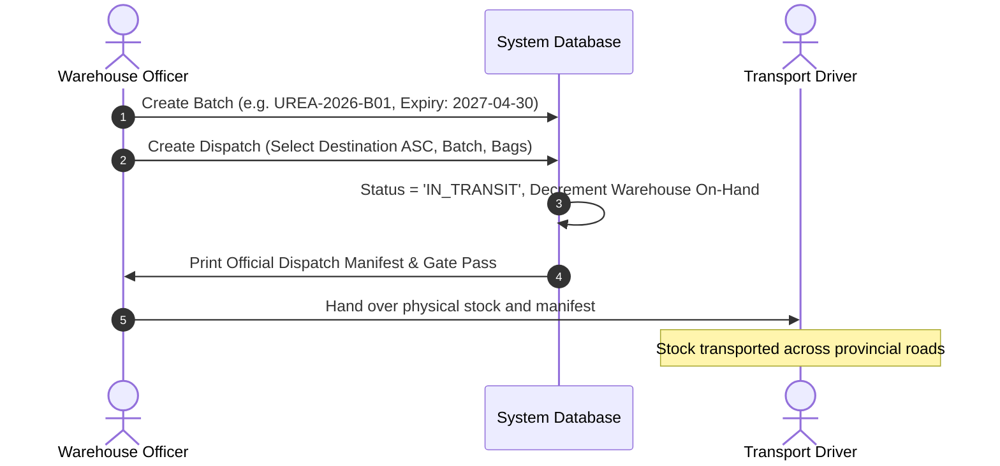
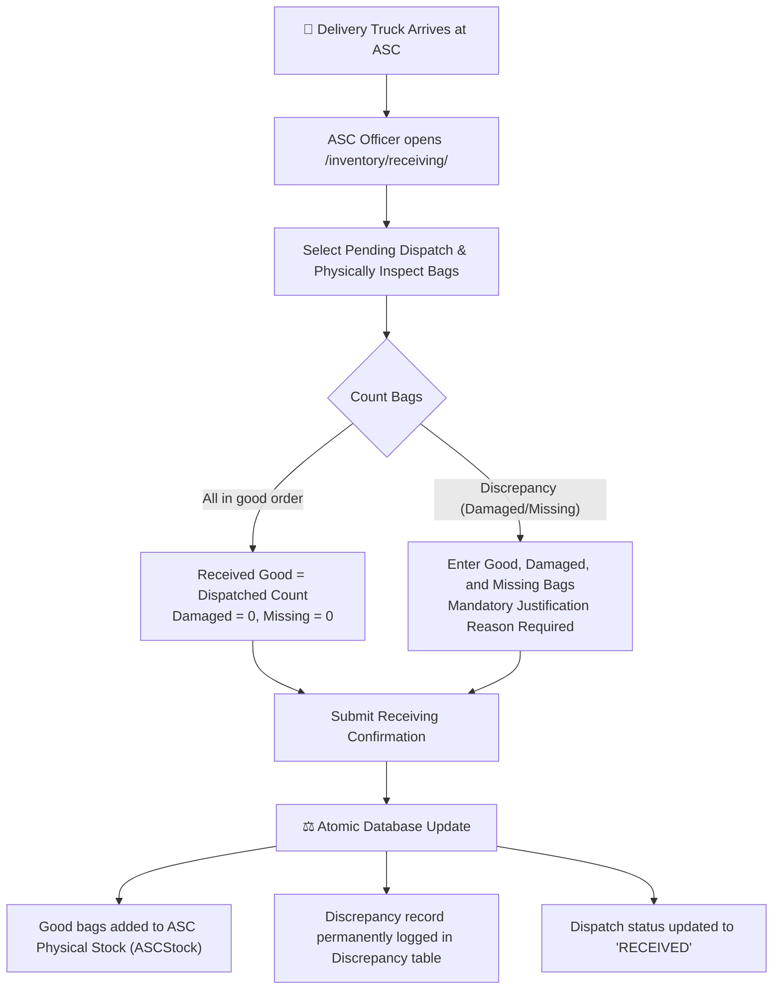
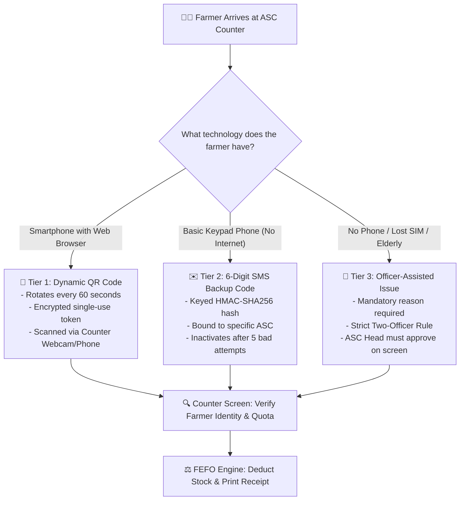
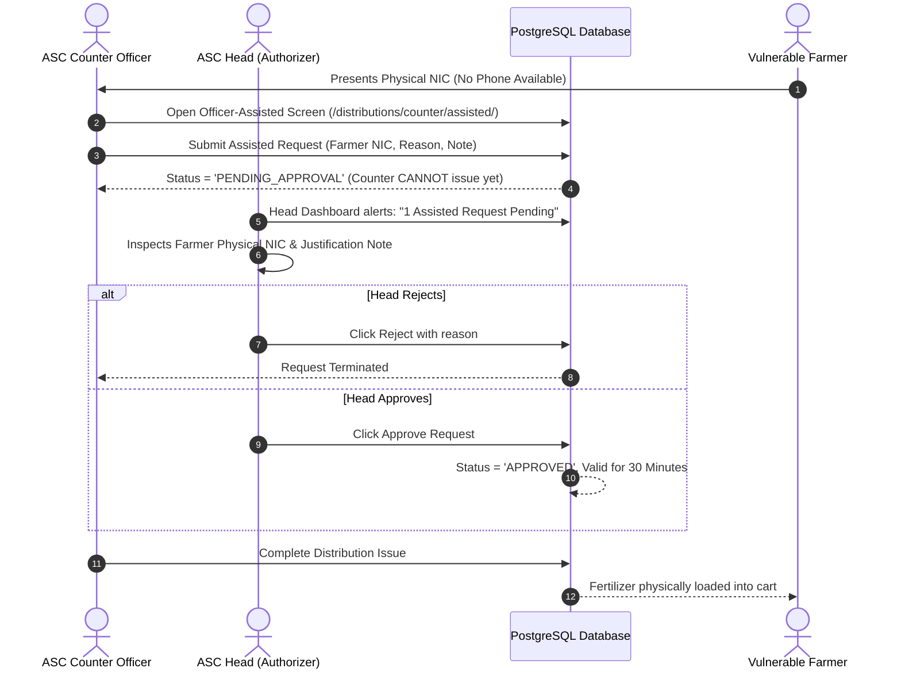
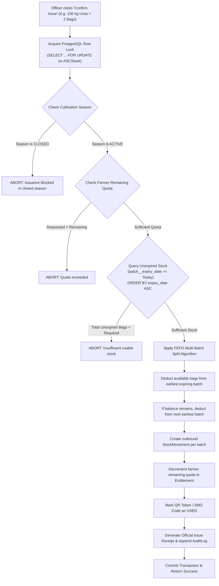
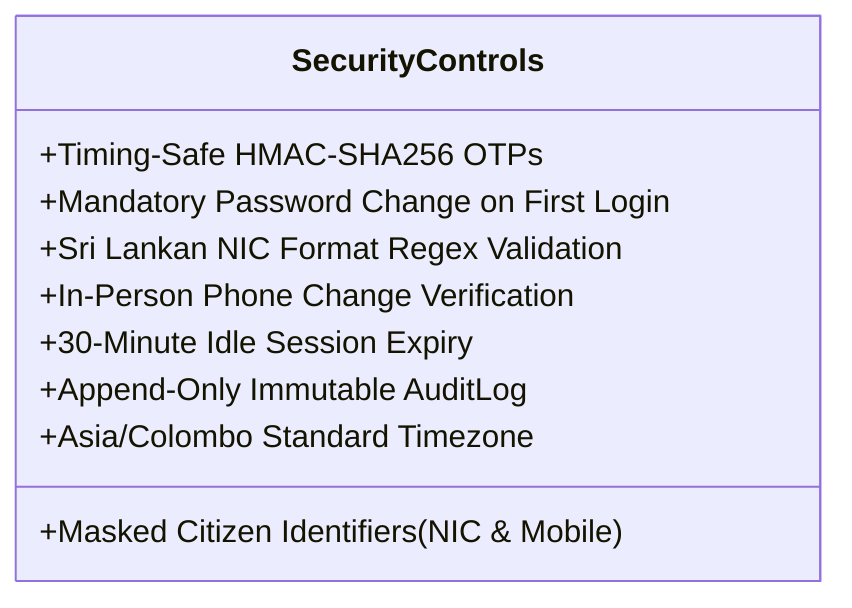

# 🌾 FertiTracker — National Fertilizer Stock & Farmer Distribution Traceability System
## Comprehensive Government Operational Manual & System Handover Report
**Document Ref:** `FT-GOM-2026-V1.0`  
**Target Authority:** Department of Agrarian Development, Ministry of Agriculture, Sri Lanka  
**Operating Centres:** Agrarian Service Centres (ASCs), Fertilizer Warehouses, District & National Audit Offices  
**Classification:** Official / Government Operational Document  
**Project Authority:** Faculty of Technological Studies, University of Vavuniya (Course TICT3153 / ICT Expo 5.0)  

---

## 📑 Table of Contents
1. [Executive Summary & Institutional Purpose](#1-executive-summary--institutional-purpose)
2. [Institutional Stakeholders & Role-Based Access Control (RBAC)](#2-institutional-stakeholders--role-based-access-control-rbac)
3. [End-to-End Operational Workflows](#3-end-to-end-operational-workflows)
   - [Workflow 1: Cultivation Season Setup & Single Active Season Invariant](#workflow-1-cultivation-season-setup--single-active-season-invariant)
   - [Workflow 2: Farmer Registration & Entitlement Quota Management (Two-Phase CSV)](#workflow-2-farmer-registration--entitlement-quota-management-two-phase-csv)
   - [Workflow 3: Central Warehouse Dispatch & Batch Creation](#workflow-3-central-warehouse-dispatch--batch-creation)
   - [Workflow 4: ASC Receiving, Damage Inspection & Discrepancy Reconciliation](#workflow-4-asc-receiving-damage-inspection--discrepancy-reconciliation)
   - [Workflow 5: Three-Tier Farmer Verification & Issuance](#workflow-5-three-tier-farmer-verification--issuance)
     - [Option A: Dynamic Browser QR Scanner (Smartphone Farmers)](#option-a-dynamic-browser-qr-scanner-smartphone-farmers)
     - [Option B: Keypad SMS Verification (Basic Feature Phone Farmers)](#option-b-keypad-sms-verification-basic-feature-phone-farmers)
     - [Option C: Officer-Assisted Two-Officer Rule (Vulnerable / Phone-Less Farmers)](#option-c-officer-assisted-two-officer-rule-vulnerable--phone-less-farmers)
   - [Workflow 6: Atomic Issue Transaction & FEFO Inventory Engine](#workflow-6-atomic-issue-transaction--fefo-inventory-engine)
   - [Workflow 7: Low-Stock Alerts & Expired Stock Write-Off](#workflow-7-low-stock-alerts--expired-stock-write-off)
   - [Workflow 8: End-to-End Batch Traceability & Public Audit Reports](#workflow-8-end-to-end-batch-traceability--public-audit-reports)
4. [Anti-Fraud, Data Privacy & Security Architecture](#4-anti-fraud-data-privacy--security-architecture)
5. [Field Infrastructure, Hardware & Network Deployment](#5-field-infrastructure-hardware--network-deployment)
6. [Field Emergency Procedures & Troubleshooting Guide](#6-field-emergency-procedures--troubleshooting-guide)
7. [System Credentials, Screen Directory & Quick Reference](#7-system-credentials-screen-directory--quick-reference)

---

## 1. Executive Summary & Institutional Purpose

### 1.1 The Operational Challenge
In Sri Lanka, chemical fertilizer subsidies represent one of the most critical government interventions for national food security. Historically, the distribution chain operating across the **560+ Agrarian Service Centres (ASCs)** has relied on manual, paper-based registers. This paper paradigm produces severe systemic vulnerabilities:
- **Disconnection of Chain of Custody**: Central warehouse dispatches and physical ASC stock are disconnected, making in-transit diversion and undocumented loss undetectable.
- **Quota Abuse & Duplicate Issuance**: Paper fertilizer coupons or verbal identification allow unscrupulous intermediaries to claim subsidies multiple times across adjacent ASCs.
- **Expiry Wastage (Lack of FEFO)**: Without automated tracking, older stock remains buried at the back of ASC godowns while newly arrived dispatches are issued first. Bags degrade, absorb humidity, and expire.
- **Digital Exclusion of Marginalized Farmers**: Many digital systems fail because they require smartphones and constant high-speed mobile data, leaving elderly, disabled, or low-income farmers with basic keypad phones unable to access subsidies.

### 1.2 The FertiTracker Solution
**FertiTracker** is a secure, web-based national traceability platform designed specifically for the operational realities of Sri Lankan agriculture. It establishes an unbroken digital chain of custody from fertilizer manufacture/import to farmer soil:
1. **End-to-End Custody Tracking**: Every batch is tracked from warehouse dispatch through in-transit custody to ASC receiving, counter issuance, and field application.
2. **First-Expired-First-Out (FEFO) Allocation**: Earliest-expiring unexpired stock is automatically reserved and issued first, automatically splitting across batches when required and strictly blocking expired chemicals.
3. **Inclusive Three-Tier Verification**: Accommodates all farming demographics:
   - *Smartphone farmers* use zero-install dynamic QR codes.
   - *Keypad phone farmers* use HMAC-SHA256 secured 6-digit SMS backup codes.
   - *Vulnerable or phone-less farmers* use an Officer-Assisted workflow strictly governed by a **Two-Officer Rule** requiring ASC Head approval.
4. **PostgreSQL Concurrency Hardening**: Utilizes database-level row locks (`SELECT ... FOR UPDATE`) to prevent simultaneous double-redemption or quota over-issuance.
5. **Full Trilingual Compliance**: Flawless real-time language switching across **Sinhala (සිංහල)**, **Tamil (தமிழ்)**, and **English**, compliant with the Official Languages Commission of Sri Lanka.



---

## 2. Institutional Stakeholders & Role-Based Access Control (RBAC)

FertiTracker strictly enforces the principle of least privilege. Every system user is assigned one institutional role with role-specific views and controls:

| Institutional Role | Primary Responsibilities | Access Boundaries & Permissions |
|---|---|---|
| **System Administrator**<br/>*(Ministry / Department IT Directorate)* | Master system configuration, cultivation seasons management, user provisioning, audit inspection. | Full administrative read/write over master data; cannot bypass business rules (cannot issue fertilizer directly). |
| **Warehouse Officer**<br/>*(Ceylon Fertilizer Co. / Regional Buffer)* | Batch creation, quality/expiry tracking, dispatch generation, vehicle/driver assignment. | Read/write dispatches and warehouse inventory; zero access to farmer quotas or ASC distribution counters. |
| **ASC Counter Officer**<br/>*(Agrarian Service Centre Front Desk)* | Farmer registration, receiving dispatches, scanning QR, issuing SMS codes, counter distribution. | Restricted strictly to their assigned ASC; cannot approve their own assisted issue requests; cannot write off stock. |
| **ASC Head Officer**<br/>*(Divisional Officer / Centre Head)* | Operational oversight, Two-Officer assisted issue approvals, expired stock write-offs. | Holds `is_asc_head=True`; authorizes exceptions; cannot self-approve requests they initiated. |
| **Internal / National Auditor**<br/>*(Auditor General's Dept / Ministry Audit)* | Discrepancy investigation, exception rate monitoring, batch lifecycle inspection. | **Strictly Read-Only** (`GET` only). Any attempted `POST`, `PUT`, or `DELETE` is blocked by decorators with HTTP 403 Forbidden. |
| **Registered Farmer**<br/>*(Agrarian Citizen Beneficiary)* | Viewing season entitlement, generating 60s dynamic QR code, inspecting digital receipt history. | Authenticated citizen portal; can only view their own personal profile, quota, and history. |

---

## 3. End-to-End Operational Workflows

### Workflow 1: Cultivation Season Setup & Single Active Season Invariant



#### Operational Steps:
1. The **System Administrator** logs into the portal at `https://fertitracker.gov.lk/login/`.
2. Under **Season Management**, all registered seasons (e.g., *Maha 2026/2027*, *Yala 2027*) are listed with their date windows and status.
3. Clicking **Toggle Season Status** activates the selected season.
4. **Business Rule Guaranteed by System**: *There can NEVER be more than one open season at any time.* Activating a season atomically closes all others. If an ASC officer attempts to issue fertilizer against a closed season, the central transaction aborts with a validation error.

---

### Workflow 2: Farmer Registration & Entitlement Quota Management (Two-Phase CSV)

#### Step 2A: Individual Farmer Registration (Front Desk)
1. An unregistered farmer visits the ASC with their National Identity Card (NIC).
2. The **ASC Counter Officer** navigates to `/distributions/farmers/manage/`.
3. The officer enters:
   - **NIC Number**: Validates both Sri Lankan formats:
     - *Legacy Format*: 9 numeric digits followed by `V` or `X` (e.g. `197512345V`).
     - *Modern Format*: 12 numeric digits (e.g. `198512345678`).
   - **Mobile Phone Number**: Validates Sri Lankan mobile prefix (`07XXXXXXXX`).
   - **Farmer Full Name** and **Assigned ASC**.
4. The account is created with `is_account_active=False` (starts **INACTIVE**).
5. The farmer verifies their phone via a 6-digit OTP sent via SMS to activate their digital portal access.

#### Step 2B: Bulk Entitlement Quota Import (Ministry / District Level)
When the Ministry issues district fertilizer subsidy allocations, thousands of farmer quotas must be loaded without corrupting existing records:



1. **Download Official Template**: The officer clicks **Download Sample CSV** at `/distributions/entitlements/csv-sample/`. The file downloads with a **UTF-8 Byte Order Mark (`\ufeff`)**, ensuring it opens cleanly in Microsoft Excel on Windows without garbling Sinhala or Tamil characters.
2. **Upload CSV**: The file contains three headers: `nic,product,quantity_kg`.
3. **Phase 1 (Validation Preview)**: The system inspects every row:
   - Validates that the farmer NIC exists in the national database.
   - Validates that the fertilizer product code (e.g. `UREA`, `TSP`, `MOP`) is registered.
   - Validates that `quantity_kg` is a positive decimal number.
   - If *any* row fails, it is highlighted in **red** with a clear explanation, and the commit button is disabled.
4. **Phase 2 (Atomic Commit)**: Once all rows are valid, the officer clicks **Confirm & Commit Import**. The operation runs inside an atomic transaction; if an unexpected crash occurs, the database rolls back completely to prevent half-imported data.

---

### Workflow 3: Central Warehouse Dispatch & Batch Creation



1. The **Warehouse Officer** at the central hub (e.g., Hunupitiya or Northern Regional Store) logs in at `/inventory/dispatches/create/`.
2. Selects the destination ASC (e.g., *Vavuniya South ASC*).
3. Selects the fertilizer batch and specifies the bag count (e.g., 200 bags of Urea, 50kg each).
4. Records driver name, vehicle registration number (e.g., `WP-NB-8822`), and dispatch note.
5. The system marks the dispatch as `IN_TRANSIT` and generates a printable dispatch manifest.

---

### Workflow 4: ASC Receiving, Damage Inspection & Discrepancy Reconciliation

When the truck arrives at the Agrarian Service Centre, physical verification is legally mandatory:



#### Golden Rules for Receiving:
- **No Over-Receiving**: The sum of `Good + Damaged + Missing` cannot exceed the dispatched quantity.
- **Mandatory Justification**: If even 1 bag is damaged or missing, the officer *must* enter an explanatory note (e.g., *"2 bags burst due to rain during transport; driver endorsed manifest"*).
- **Physical Segregation**: Damaged bags are never added to usable inventory; only good bags increase `bags_on_hand`.
- **Anti-Duplication**: A dispatch can only be received once. Concurrency locks prevent two officers from receiving the same truck twice.

---

### Workflow 5: Three-Tier Farmer Verification & Issuance

FertiTracker provides three distinct verification pathways to ensure **100% digital inclusion** of all rural farmers:



#### Option A: Dynamic Browser QR Scanner (Smartphone Farmers)
1. Farmer logs into their portal at `https://fertitracker.gov.lk/farmer/dashboard/`.
2. The screen renders a high-contrast QR code that **automatically refreshes every 60 seconds**.
3. The counter officer clicks **Scan QR Code** (`/distributions/counter/scan/`). The browser opens the counter webcam or USB barcode reader.
4. Upon scanning, the system executes Step 1 (Verify): Displays farmer name, masked NIC (`1985****5678`), assigned village, approved quota, and remaining kg.
5. Officer enters bags to issue and clicks **Confirm Issue**.

#### Option B: Keypad SMS Verification (Basic Feature Phone Farmers)
1. If the farmer carries a basic feature phone (Nokia, etc.) without internet:
2. Officer clicks **SMS Backup Code** at `/distributions/counter/sms-code/`.
3. System dispatches a secure 6-digit verification code to the farmer's registered mobile phone.
4. Farmer reads the 6-digit code from their SMS inbox to the officer.
5. **Security Controls**:
   - Stored using keyed **HMAC-SHA256** (cannot be reversed even if database is inspected).
   - Code is cryptographically bound to that specific ASC (cannot be intercepted and redeemed elsewhere).
   - If an officer or attacker inputs 5 wrong codes, the counter locks for 10 minutes and writes a security alert to `AuditLog`.

#### Option C: Officer-Assisted Issue Workflow (Two-Officer Rule)
For vulnerable, elderly, or disabled citizens who possess no phone, FertiTracker implements the strict **Two-Officer Rule** practiced in central banking and government treasuries:



> [!CRITICAL]
> **Anti-Collusion Mechanism**: If the counter officer who created the assisted request attempts to approve it using their own account, the system rejects the transaction with: `ValidationError("You cannot approve your own assisted issue request")`. Approval *must* come from an independent ASC Head (`is_asc_head=True`).

---

### Workflow 6: Atomic Issue Transaction & FEFO Inventory Engine

When an issue is confirmed at the counter, the **Atomic Issue Service** executes the following steps in a single database transaction (`@transaction.atomic`):



#### Traceability Guarantee:
If a farmer receives 100 kg (2 bags), and Batch A (expiring next month) only has 1 bag left, the system takes 1 bag from Batch A and 1 bag from Batch B (expiring next year). Two separate `StockMovement` records are created, guaranteeing that every single bag taken home by a farmer is tied to its originating manufacturing batch.

---

### Workflow 7: Low-Stock Alerts & Expired Stock Write-Off

#### Low-Stock & Expiry Indicators
The ASC dashboard displays real-time health badges for every fertilizer product:
- 🟢 **HEALTHY**: Stock is above threshold and expiry is $> 60$ days away.
- 🟡 **LOW STOCK**: Stock is below the ASC threshold (default 10 bags; configurable by Admin).
- 🟠 **NEAR EXPIRY**: Batches expiring within the next 60 days. The FEFO engine prioritizes issuing these immediately.
- 🔴 **EXPIRED**: Batches where `expiry_date < Today`. **Strictly blocked from issue.**

#### Expired Stock Write-Off Procedure
If a batch expires before it can be distributed (e.g., due to flood damage or packaging breach):
1. **ASC Head** logs into `/inventory/write-off/`.
2. Selects the expired batch and specifies the number of spoiled bags.
3. Enters a mandatory justification (e.g. *"Submerged during November river flood; inspected and condemned by Agrarian Inspector"*).
4. System creates an append-only `StockMovement(movement_type='WRITE_OFF')` and an `AuditLog` entry.
5. **No records are deleted** from the database. The physical count is reduced while the complete paperless audit trail is preserved forever.

---

### Workflow 8: End-to-End Batch Traceability & Public Audit Reports

#### 1. Batch Traceability Explorer (`/distributions/reports/batch-trace/`)
By entering any batch code (e.g., `UREA-2026-B01`), agrarian auditors can inspect the complete life story of that fertilizer:
- **Phase 1: Production**: Originating warehouse, manufacture date, expiry date.
- **Phase 2: Dispatches**: All trucks sent to ASCs with vehicle numbers and transit timestamps.
- **Phase 3: Receiving**: Good, damaged, and missing bag counts per ASC.
- **Phase 4: Current Physical Balances**: Exact on-hand bags across every ASC godown.
- **Phase 5: Farmer Distributions**: Exact list of farmers who received bags from this batch (with masked NICs for citizen privacy).
- **Phase 6: Condemnations**: Any written-off bags and authorizer identities.
- **Reconciliation Formula**:
  $$\text{Dispatched Bags} = \text{Received Good} + \text{Damaged} + \text{Missing} + \text{In Transit}$$

#### 2. Discrepancy & Exception Reports (`/inventory/discrepancies/`)
Summarizes all damaged and missing bags recorded across the country, highlighting high-loss transit corridors and specific transport contractors.

#### 3. Assisted-Issues Oversight Report (`/distributions/reports/assisted-issues/`)
Tracks the ratio of Assisted Issues vs. Digital QR/SMS issues per ASC. If an ASC shows an abnormally high assisted-issue rate (e.g., $>20\%$), the Ministry can audit that centre for potential ghost-farmer fraud.

#### 4. Excel-Friendly CSV Exports
All report pages feature a **Download CSV** button. The file is generated with a **UTF-8 Byte Order Mark (`\ufeff`)**, ensuring that Sinhala (`සිංහල`) and Tamil (`தமிழ்`) scripts render with 100% typography fidelity in Microsoft Excel on Windows without mojibake.

---

## 4. Anti-Fraud, Data Privacy & Security Architecture



### 4.1 Citizen Privacy by Design (PII Masking)
Under government circulars and personal data protection best practices, citizen national identity numbers and mobile numbers are never displayed unmasked on public counters or printed reports:
- **NIC Numbers**: `198512345678` is displayed as `1985****5678`.
- **Mobile Phones**: `0771234567` is displayed as `077****567`.
- **Phone Number Changes**: If a farmer changes their phone number, an ASC Officer must physically check their original NIC card and tick an *"I verified the original NIC in person"* confirmation. The audit log permanently records both the old and new masked numbers (`077****233` $\rightarrow$ `071****677`).

### 4.2 Append-Only Audit Log Immutability
To prevent internal tampering by corrupt officials, the `AuditLog` table is programmatically protected at three levels:
1. **Model Level**: Calling `.save()` on an existing log raises `ValidationError("AuditLog records are append-only and cannot be modified.")`. Calling `.delete()` raises a validation error.
2. **QuerySet Level**: Bulk operations such as `AuditLog.objects.filter(...).delete()` or `.update(...)` are blocked by custom exceptions.
3. **Admin Console Level**: The Django Admin disables add, change, and delete permissions for `AuditLogAdmin`.

### 4.3 Timezone Integrity
All calculations are pinned strictly to **Sri Lanka Standard Time (`Asia/Colombo`, UTC+5:30)** using `django.utils.timezone.localdate()`. This prevents a 5.5-hour UTC discrepancy from causing premature batch expiration or season cutoff miscalculations.

---

## 5. Field Infrastructure, Hardware & Network Deployment

### 5.1 ASC Counter Hardware Requirements
FertiTracker is built to run on standard low-cost office equipment commonly found in Sri Lankan Agrarian Service Centres:
- **PC / Laptop**: Any computer running Windows 10/11, Ubuntu Linux, or macOS with 4GB RAM.
- **Web Browser**: Google Chrome, Mozilla Firefox, or Microsoft Edge (no proprietary software needed).
- **Scanner / Camera**: Standard USB webcam (e.g. Logitech C270), built-in laptop webcam, or barcode reader.
- **Printer**: Standard A4/A5 laser printer or thermal slip receipt printer (supports browser `window.print()`).
- **Power Backup**: Standard 650VA UPS to preserve counter availability during rural load shedding.

### 5.2 Offline & Poor Connectivity Architecture
- All stylesheets (Tailwind CSS) and JavaScript libraries (`html5-qrcode`, `qrcode.min.js`) are hosted **100% locally** inside the codebase (`/static/`). The system operates without internet connectivity on an ASC local area network (LAN).
- For mobile devices during live exhibitions or field demonstrations, running Cloudflare Tunnel:
  ```powershell
  cloudflared tunnel --url http://127.0.0.1:8000
  ```
  Provides a secure `https://` endpoint allowing mobile browsers to access camera hardware via WebRTC `getUserMedia()`.

### 5.3 Pluggable SMS Gateway
The system uses an abstract SMS architecture configured via `.env`:
- `SMS_BACKEND=distributions.sms.SimulatedSMSBackend` (Logs OTPs to console and the Demo SMS Inbox for evaluations).
- In production, swap to commercial telco gateways:
  - **Mobitel m-Space REST API**
  - **Dialog IdeaMart SMS Gateway**
  - **Lanka Government Network (LGN) SMS Gateway**

---

## 6. Field Emergency Procedures & Troubleshooting Guide

| Issue / Incident | Root Cause | Immediate Field Officer Procedure |
|---|---|---|
| **Farmer's smartphone screen is cracked / QR won't scan** | Optical reflection or scratched glass. | Click **SMS Backup Code** to send a 6-digit code, or use **Officer-Assisted Issue** with ASC Head approval. |
| **Farmer does not have a phone or SIM card is lost** | Keypad phone forgotten or lost. | Initiate an **Officer-Assisted Issue** (`/distributions/counter/assisted/`). Require the farmer's physical NIC card and have the ASC Head approve on their screen. |
| **Incoming dispatch has burst or wet bags** | Road transit damage or rain leak. | Enter good bags under *Received Good*, and record broken bags under *Damaged*. Enter a mandatory note and obtain the truck driver's signature on the physical manifest. |
| **Farmer claims quota is incorrect (e.g. 50kg instead of 100kg)** | Agrarian data discrepancy from divisional land registry. | Officer contacts District Agrarian Officer. Admin/Officer uses **Edit Entitlement** (`/distributions/entitlements/<id>/edit/`), which logs old and new quota values to the immutable audit log. |
| **Officer forgets password or gets locked out** | 5 consecutive wrong passwords entered. | System Administrator resets the password via `/accounts/officers/`. The system issues a 12-char temp password and forces a password change upon first login. |
| **Power or Internet Failure during counter issue** | Grid load shedding or fiber cutoff. | Transactions in progress roll back automatically due to PostgreSQL ACID compliance. Upon power resumption, scan the farmer's QR again. The quota will reflect the accurate, uncorrupted balance. |

---

## 7. System Credentials, Screen Directory & Quick Reference

### 7.1 Pre-Configured Demonstration Accounts (DEMO ONLY)
> [!NOTE]
> All demonstration passwords are pre-configured to `Password123!`.

| Role | Username | Password | Assigned Location | Operational Scope |
|---|---|---|---|---|
| **System Administrator** | `admin` | `Password123!` | Ministry Head Office | Master data, users, seasons, full system audit |
| **Warehouse Officer** | `wh_officer` | `Password123!` | Northern Regional Hub | Batch creation, dispatch manifests |
| **ASC Counter Officer** | `asc_officer` | `Password123!` | Vavuniya South ASC | Counter scanning, receiving stock, issuing fertilizer |
| **ASC Head Officer** | `asc_head` | `Password123!` | Vavuniya South ASC | Assisted issue approvals, expired stock write-offs |
| **Government Auditor** | `auditor` | `Password123!` | Auditor General Dept | Read-only analytics, discrepancy & exception audit |
| **Registered Farmer** | `farmer1` | `Password123!` | Vavuniya South ASC | Dynamic QR generation, quota history inspection |

### 7.2 Primary Operational URL Directory

| Operational Screen | URL Path | Permitted User Roles |
|---|---|---|
| **System Login** | `/login/` | All Users |
| **Role Dashboard** | `/accounts/dashboard/` | Role-tailored context |
| **Officer Management** | `/accounts/officers/` | System Administrator |
| **Farmer Management & Registration** | `/distributions/farmers/manage/` | ASC Officer, Admin |
| **Two-Phase CSV Quota Import** | `/distributions/entitlements/csv-preview/` | ASC Officer, Admin |
| **Sample Quota CSV Download** | `/distributions/entitlements/csv-sample/` | ASC Officer, Admin |
| **Create Warehouse Dispatch** | `/inventory/dispatches/create/` | Warehouse Officer, Admin |
| **ASC Receiving & Inspection** | `/inventory/receiving/` | ASC Officer, ASC Head, Admin |
| **Dynamic QR Counter Scanner** | `/distributions/counter/scan/` | ASC Officer, ASC Head |
| **SMS Backup Code Entry** | `/distributions/counter/sms-code/` | ASC Officer, ASC Head |
| **Officer-Assisted Issue Request** | `/distributions/counter/assisted/` | ASC Officer, ASC Head |
| **Expired Stock Write-Off** | `/inventory/write-off/` | ASC Head, Admin |
| **Batch Traceability Explorer** | `/distributions/reports/batch-trace/` | Auditor, Admin, ASC Head |
| **Discrepancy Investigation Report**| `/inventory/discrepancies/` | Auditor, Admin, ASC Head |
| **Searchable Immutable Audit Log** | `/distributions/audit/logs/` | Auditor, Admin |
| **Farmer Citizen Portal** | `/farmer/dashboard/` | Registered Farmers |
| **Simulated Demo SMS Inbox** | `/sms/demo-inbox/` | All Roles (Demo & Evaluation) |

---

## 8. Verification & Test Certification

The entire system architecture has been tested and certified under **PostgreSQL 16**:
- **Automated Test Suite**: 60 Test Cases covering multi-threaded concurrency, row-level locking (`SELECT ... FOR UPDATE`), brute-force lockout, HMAC hashing, FEFO stock splitting, CSV BOM parsing, and immutable audit logs.
- **Pass Rate**: **100% OK (60 of 60 tests passed)**.
- **Verification Matrix Reference**: See [`docs/test_cases.md`](file:///c:/Users/anupa/Documents/Code/fertitracker/docs/test_cases.md) for full traceability matrix.

---
**Report Compiled by:** University of Vavuniya Individual Project Team  
**Course & Event:** TICT3153 — Software Engineering Project (ICT Expo 5.0)  
**Department:** Department of Interdisciplinary Studies, Faculty of Technological Studies  
**Date:** November 2026
